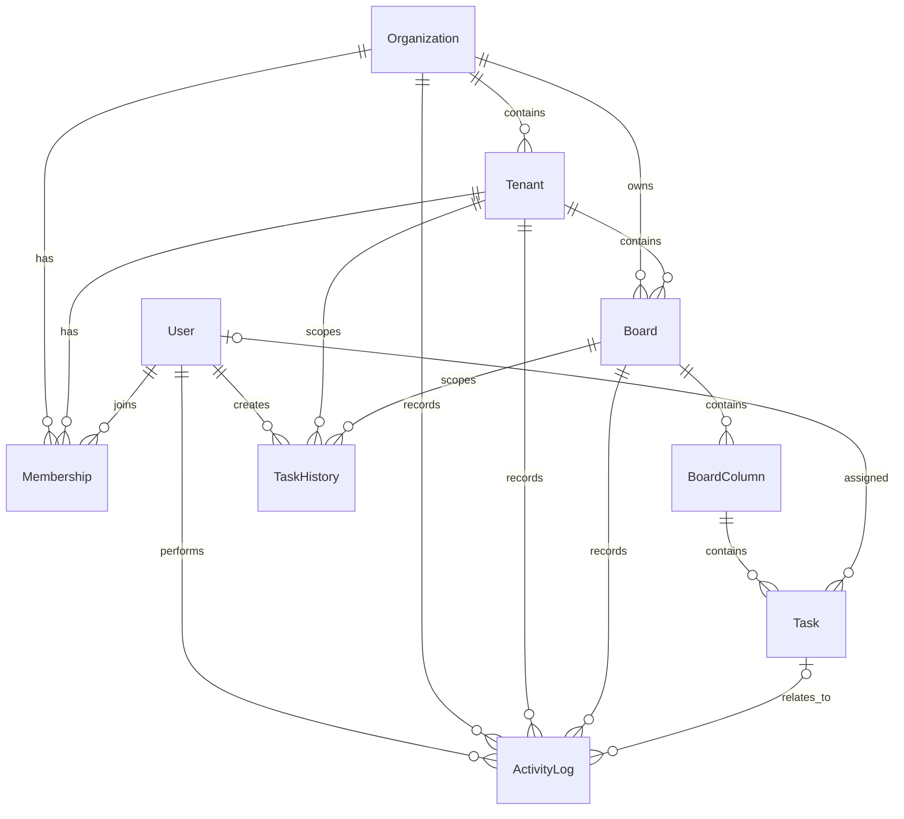

# Database ER Diagram

The JulleyOnline application uses PostgreSQL as its relational database and Prisma ORM for database management.

## 1. Entity Relationship Diagram

The following diagram represents the database entities and their relationships.

## 2. Database Entities

### 2.1 Organization

Represents the top-level organization in the multi-tenant architecture.

**Responsibilities:**
- Stores organization information.
- Acts as the parent of multiple tenants.
- Provides organization-level resource isolation.
- Owns boards associated with the organization.

### 2.2 Tenant

Represents a branch or tenant belonging to an organization.

**Responsibilities:**
- Belongs to an organization.
- Provides tenant-level data isolation.
- Contains boards.
- Connects users through membership records.

### 2.3 User

Stores user account and authentication information.

**Responsibilities:**
- Stores user profile information.
- Supports authentication.
- Connects users to organizations and tenants through memberships.
- Tracks task assignments and user activities.

### 2.4 Membership

Connects users to organizations and tenants and defines their access permissions.

**Supported roles:**

| Role | Description |
|---|---|
| ORG_ADMIN | Organization-level administrator |
| TENANT_ADMIN | Tenant-level administrator |
| MEMBER | Standard tenant member |

The membership relationship is used to enforce role-based access control and tenant-level authorization.

### 2.5 Board

Represents a Kanban board associated with an organization and tenant.

**Responsibilities:**
- Belongs to an organization.
- Belongs to a tenant.
- Contains multiple columns.
- Provides the workspace for task collaboration.

### 2.6 BoardColumn

Represents a column within a Kanban board.

**Responsibilities:**
- Belongs to a board.
- Contains multiple tasks.
- Maintains its position within the board.
- Supports column creation, modification, and deletion.

### 2.7 Task

Represents an individual task within a board column.

**Responsibilities:**
- Belongs to a column.
- Supports task creation, updating, deletion, and movement.
- Stores task priority and other task information.
- Maintains its position within a column.
- Uses version tracking for optimistic concurrency control.
- Supports assignment to users.

**Supported task priorities:**
- LOW
- MEDIUM
- HIGH
- URGENT

### 2.8 ActivityLog

Stores recorded activities performed by users.

**Responsibilities:**
- Records user actions.
- Associates activities with organization and tenant context.
- Associates activities with boards and tasks when applicable.
- Maintains an activity record for application operations.

### 2.9 TaskHistory

Stores task state snapshots used by the undo and redo functionality.

**Responsibilities:**
- Records task creation, updates, movements, and deletion.
- Stores before-state and after-state information.
- Associates history records with a user, tenant, and board.
- Tracks whether a history operation has been applied or undone.
- Supports user-specific undo and redo operations.

## 3. Entity Relationships

| Relationship | Description |
|---|---|
| Organization → Tenant | An organization can contain multiple tenants. |
| Organization → Membership | An organization can have multiple membership records. |
| Tenant → Membership | A tenant can have multiple membership records. |
| User → Membership | A user can have multiple membership records. |
| Organization → Board | An organization can own multiple boards. |
| Tenant → Board | A tenant can contain multiple boards. |
| Board → BoardColumn | A board can contain multiple columns. |
| BoardColumn → Task | A column can contain multiple tasks. |
| User → Task | A user can be assigned multiple tasks. |
| User → ActivityLog | A user can perform multiple recorded activities. |
| Board → ActivityLog | A board can have multiple activity records. |
| User → TaskHistory | A user can have multiple task history records. |
| Board → TaskHistory | A board can have multiple task history records. |

## 4. Database Constraints and Design Considerations

### Multi-Tenant Isolation

- Each tenant belongs to an organization.
- Membership records determine which users can access an organization and its tenants.
- Board access is validated against the user's organization and tenant permissions.
- Cross-tenant and cross-organization access is restricted.

### Role-Based Access Control

The membership role determines the operations available to a user.

- Organization administrators have organization-level administrative permissions.
- Tenant administrators have tenant-level administrative permissions.
- Members have standard tenant-level permissions.

### Task Ordering

- Columns maintain their positions within a board.
- Tasks maintain their positions within a column.
- Column positions are unique within a board.
- Task positions are unique within a column.

### Concurrency Control

- Tasks maintain a version number.
- Updates validate the expected task version.
- Stale updates are rejected with an HTTP 409 conflict response.
- This prevents an older client state from silently overwriting a newer update.

### Task History

- Task history stores before-state and after-state snapshots.
- History is scoped by user and board.
- Undo and redo operations restore previous task states.
- History operations maintain their applied or undone status.

## 5. Important Implementation Note

The `TaskHistory.taskId` field is stored as a string and is not a foreign-key relationship to the `Task` model.

This design allows task history records to retain references to tasks even after those tasks have been deleted.

## 6. Database Technology

| Component | Technology |
|---|---|
| Database | PostgreSQL |
| ORM | Prisma |
| Schema Definition | Prisma Schema |
| Migration Management | Prisma Migrate |
| Concurrency Strategy | Optimistic Concurrency Control |
| History Management | Task State Snapshots |

## 7. Summary

The database design supports the core requirements of JulleyOnline:

- Multi-organization and multi-tenant architecture.
- User membership and role-based authorization.
- Board, column, and task management.
- Tenant-level data isolation.
- Efficient task ordering.
- Concurrent task update detection.
- Activity logging.
- User-specific undo and redo functionality.

The relational structure provides a foundation for secure, real-time collaboration across multiple organizations and tenants.
